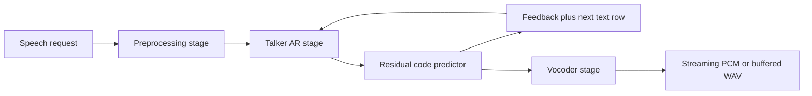
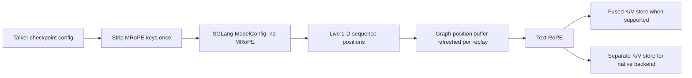

# Mechanical decomposition and source audit

## Shared pipeline

Preprocessing may share the engine process or construct a standalone prompt frontend. The frontend owns only the prompt embeddings, text projection and speaker encoder. It sends prepared tensors across the stage boundary; it does not execute the transformer. The engine retains request-owned prompt rows and generated-input history. The vocoder consumes codec frames, not the talker staging table. None of these PRs changes vocoder scheduling, invalid-row detection, copy events or audio transport.

## Input ownership and execution order: 2913

1. `prepare_qwen3_tts_request` dispatches Base, CustomVoice or VoiceDesign prompt construction, creates device-row cache IDs and stores projected prompt/text/pad rows. The codec parameter supplies device, dtype and width after this PR.
2. Same-process preprocessing records a ready event and stores a prepared-request object; the engine consumes it and adopts the tensors on its stream. Standalone preprocessing serializes those tensors in `Qwen3TTSState`, and `load_prepared_qwen3_tts_request` reconstructs them on the engine device/dtype.
3. The request builder retains prompt embeddings, initializes the text FIFO and pad row, and marks prompt rows as already projected.
4. `before_prefill` takes exactly the scheduled extend slice. Prefix-cache hits skip retained rows. A retracted request appends generated-input history and, if necessary, consumes the one pending feedback/text row needed to complete that history. A missing or incorrectly sized slice raises before forward.
5. The Omni prefill sidecar keeps embeddings off upstream admission fields. `SGLModelRunner._extend_forward_kwargs` passes them after graph admission. Capture/replay supplies a persistent embedding slot; eager execution supplies the same explicit tensor. The sidecar is cleared in `finally`.
6. At a terminal prefill chunk or decode step, the semantic token is sampled, the residual predictor runs, and output extraction resolves EOS. For a non-EOS row, `post_process_outputs` snapshots the summed predictor embedding and queues its row. EOS does not queue another row because the request ends.
7. `before_decode` consumes feedback plus either the next text row or the text-pad row. One stack writes the decode table, one batched add adds text, and a cloned snapshot retains re-prefill history. Input IDs become staging-table row IDs.
8. Decode CUDA graphs index that table. Requests are live rows; captured padding rows do not need a scheduler feedback queue. The capacity validator reads the same table.

The removed feedback tensor/mask were not an alternate queue. Treating the missing-queue case as a bare codec embedding silently violated the model equation. A new validation pass or queue transaction is unnecessary: the scheduler's existing batch-failure path aborts that entire batch and excludes unwritten KV from the prefix cache.

## Position, rotation and cache ownership: 2914

The reference builds `position_ids` by repeating each sequence's cumulative positions on three axes. At each rotary lane, MRoPE selects one axis and uses that lane's frequency. If the three rows agree, axis selection is the identity. It neither permutes frequencies nor requires a guessed audio-rate offset.

The code drops only `interleaved`, `mrope_interleaved` and `mrope_section`; it retains rope type, theta and scaling. Root `text_config` aliases the talker config before SGLang derives `model_is_mrope`. The predictor's separate nested config is not normalized by this hook.

SGLang computes `ForwardBatch.mrope_positions` only when `model_is_mrope` is true. The normal positions still come from sequence/prefix lengths, including re-prefill. The prefill runner selects ordinary positions without the model marker. Its buffer registry copies live positions and resets padded positions before replay. The decode registry likewise refreshes positions. Some generic static buffers may still allocate an unused MRoPE slot; this PR removes its talker computation/use, not every generic allocation.

`Qwen3OmniMoeThinkerTextAttention` creates RoPE through SGLang's factory. MRoPE was excluded from fused KV writes by class. Ordinary RoPE is eligible; the fused kernel rotates Q/K and stores rotated K plus original V at `out_cache_loc`. `forward_core` then avoids a duplicate store. If the operation cannot fuse, `forward_core` must retain the ordinary KV store. The native-backend finding is a missing check at precisely this last eligibility boundary.

The JIT kernel was read through its lane mapping, NeoX half split, per-token position, head/batch strides, cache destination and V-store loop. Python validates index dtypes, shape/stride, FP32 angle cache and common device. The checkpoint head width is supported by this kernel; no new custom head-size heuristic is added by the PR.

The arithmetic changes precision: native MRoPE CUDA dispatch narrows the angle cache to BF16, while ordinary CUDA RoPE preserves FP32 angles and rounds the resulting Q/K. Equivalent position semantics therefore do not promise byte-identical model audio.

## Parameter layout, loading and prompt reduction: 2916

For residual codebook `j`, vocabulary size `V`, hidden column `h` and code `c`, the old matrix row is exactly the stacked parameter row `weight[j, c, h]`. The flattened embedding index `j*V+c` reaches that same element. Each fixed-codebook view is contiguous and its pointer includes the codebook's storage offset.

The model and frontend derive one mapping from original checkpoint names to `(stacked_parameter_name, codebook_index)`. The model custom loader is installed before the default-loader binder, which preserves existing loaders. The frontend reports missing original names, rather than considering the whole stacked parameter loaded after seeing one codebook.

The first codebook remains separate. Residual rows are embedded in one call, concatenated after the first row to the same `(frames, 16, hidden)` layout and reduced by the same `sum(1)`. Text/pad alignment and the streaming/non-streaming ICL branches are unchanged. Reassociating that reduction would require a new numerical argument and is correctly avoided.

Predictor decode takes a fresh table view per codebook. Both the CUDA gather and Torch fallback consume it. Post-load projection iterates the stacked parameter and still stops one codebook early because the last code does not feed another predictor step. Device conversion updates the registered integer offset buffer; pre-capture parameter-storage rebinding is followed by new views.

IPC source inspection confirmed attachment occurs before pool warmup and graph capture, and changes a parameter's `.data` storage. Qwen3-TTS is audit-only in the current IPC allowlist, so that inspection is not an end-to-end support claim. Its existing unregistered derived projection state is a separate follow-up when IPC support is enabled; it is not introduced by stacking these tables.

## Source coverage and reference fit

Whole production files read: the TTS model runner, request builders, prompt frontend, stage factories, engine builder, model implementation and predictor kernel; shared prefill-input transport and capacity validator; the shared talker queue/history runner; ASR model/config/MPS adapter and HF helper. Branch differences were read from each exact merge-base diff, including all changed test hunks.

Large unchanged framework files were traced through the relevant methods, not claimed as entirely reviewed: generic AR runner execution/finalization, scheduler batch failure, SGLModelRunner's sidecar and weight-sharing hooks, IPC attachment, SGLang ModelConfig/ForwardBatch position creation and prefill graph selection/buffer replay. The affected Qwen attention class was read in full.

SGLang rotary factory, base RoPE, MRoPE, Python fused wrapper and complete CUDA RoPE/store implementation were read. The multimodal-generation DAC file was also read: it has per-codebook projections/dimension boundaries and offers no suitable equal-width talker-table replacement. SGLang's generic RoPE compatibility helper adds legacy config spellings; it does not implement this model-specific equal-axis normalization.

Local SGLang head: `baa9befa381511cd4d56f83980951e5a45fffc6d`. The installed pinned 0.5.21 runtime differs in some framework files, so the actual runtime methods were inspected separately. The RoPE factory, Python fused wrapper and CUDA RoPE/store source hashes match the local checkout. See `sglang_sources.json` and verification evidence for exact hashes.

Official reference consulted: [Qwen3-TTS model implementation](https://github.com/QwenLM/Qwen3-TTS/blob/main/qwen_tts/core/models/modeling_qwen3_tts.py). The tested image's installed qwen-tts 0.1.1 decode/input/position implementation was inspected directly; the moving upstream page was not treated as the pinned serving version.
